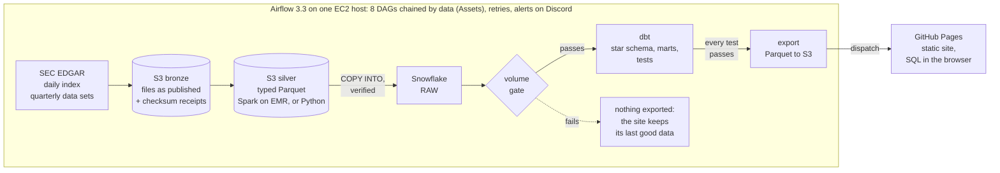

# EarningsWatch

**Flags public companies whose reported profits are outrunning their cash, from 17 years of
SEC filings, rebuilt and republished by a tested pipeline every business-day morning.**

[](https://github.com/DiegoFranGarcia/Earnings-Watch/actions/workflows/ci.yml)
[](https://diegofrangarcia.github.io/Earnings-Watch/)


When net income rises while operating cash flow falls, the gap is made of *accruals*: profit
not (yet) backed by cash. Accounting research links large accruals to lower-quality earnings and
later restatements. EarningsWatch screens every XBRL filer since 2009 for that pattern, on a data
platform built to be trusted: idempotent ingestion into a verified lake, Spark on AWS, a tested
dbt warehouse in Snowflake, and a circuit breaker that keeps bad data off the site.

> A screen for where to look harder, **not investment advice**.

**Live:** [the site](https://diegofrangarcia.github.io/Earnings-Watch/) (the screener, a page
per company, restatements, filing timeliness, [the pipeline's own record](https://diegofrangarcia.github.io/Earnings-Watch/pipeline/),
and SQL you can run against the data in your browser), and the
[dbt docs](https://diegofrangarcia.github.io/Earnings-Watch/dbt-docs/), every model, column and
test with the lineage graph.

<picture>
  <source media="(prefers-color-scheme: dark)" srcset="docs/images/overview-dark.png">
  
</picture>

*The overview, 2026-11-28.*

## What it found

- **Earnings quality:** trailing-twelve-month income rising while cash does not, with accruals
  above 10% of average assets, flags **2.2%** of the 187,949 screened company-quarters (the
  naive rule, income up and cash not: 17.3%). Of the flags a latest-values screen shows, **10%
  were not knowable at the time**: only restatements made them
  ([ADR 6](docs/adr/0006-keep-first-reported-and-latest-values.md)).
- **Restatements:** of 328,872 materially restated facts, only **10.5% are corrections**; 61.9%
  are recasts and 27.6% are XBRL tag switches
  ([ADR 7](docs/adr/0007-classify-restatements-by-their-first-material-change.md)). Another
  3,048, from 447 companies, are thousandfold scale errors, such as a 10-K/A turning a $107m
  loss into $107 billion.
- **Filing timeliness:** for fiscal 2024, 98% of large accelerated filers filed their 10-K on
  time, against 76% of non-accelerated filers.

## In numbers

| | |
|---|---:|
| SEC financial statement numbers converted, verified and loaded | **188,865,271** |
| Quarters of history (2009 Q2 to 2026 Q3) | **70** |
| Raw files in the lake, each with a checksum receipt | **847** (38.2 GB) |
| Lines quarantined / values that failed their type cast, across all history | **0 / 0** |
| Full-history conversion on Spark (EMR Serverless) | **24 min, about $0.29** |
| Spark output identical to the reference DuckDB converter | **24 of 24** quarter checks |
| Tests | **288** Python, **11** Airflow DAG, **214** dbt data, **10** dbt unit, plus the site's unit and browser tests |
| A morning's run, scheduled start to the verified live site | **under 10 minutes** |
| Running cost, before free credits | **about $31/month** ([details](#cost)) |

## Architecture



Airflow orchestrates and never crunches data. Downloads land in **bronze**, immutable and
receipted. Spark on **EMR Serverless** turns the quarterly data sets into typed **silver**
Parquet and stops; the daily index is small enough for Python. Snowflake loads each partition
idempotently, and dbt models the answer. Each DAG starts when the one before it lands its data,
not at a clock time. The host wakes for the morning's runs and sleeps the rest of the day,
starting whichever release CI last published
([ADR 12](docs/adr/0012-release-by-publishing-a-pointer-the-host-pulls.md)).

## Stack, and why

| Tool | Why it is here |
|---|---|
| **Airflow 3.3** | Logical-date scheduling, backfills, Assets linking DAGs by data, a pool as the cross-DAG SEC rate limit, deferrable waits that hold no worker |
| **S3 (bronze / silver)** | Immutable raw files with receipts; open Parquet any engine can read |
| **Spark 4.0 on EMR Serverless** | Keeps heavy compute off the orchestrator; bills per second; idle costs nothing ([ADR 2](docs/adr/0002-run-spark-on-emr-serverless-graviton.md)) |
| **DuckDB** | The single-node baseline Spark is benchmarked against, and the SQL engine in the visitor's browser ([ADR 20](docs/adr/0020-run-sql-in-the-visitors-browser.md)) |
| **Snowflake** | Separate storage and compute; reads S3 through a storage integration, with no stored keys ([ADR 4](docs/adr/0004-run-dbt-on-snowflake-and-retire-the-duckdb-target.md)) |
| **dbt** | Tested, documented models with unit tests, enforced contracts and key-based incremental merges |
| **Terraform** | AWS and Snowflake resources as reviewed code, with cost caps built in; plans stay local ([ADR 16](docs/adr/0016-check-terraform-statically-in-ci-and-plan-locally.md)) |
| **GitHub Actions** | Tests, slim dbt CI in per-PR schemas, the image built and smoke-tested, vulnerability gates, then the release; AWS through OIDC roles, with no stored keys ([ADR 13](docs/adr/0013-ci-reaches-aws-through-oidc-roles-and-holds-no-real-secret.md)) |
| **SvelteKit, static** | The site is rebuilt from each export and serves only files: nothing to run, nothing to breach ([ADR 17](docs/adr/0017-serve-a-static-site-rebuilt-by-the-pipeline.md), [ADR 19](docs/adr/0019-build-the-site-as-a-small-static-app-not-evidence.md)) |

Every non-obvious choice is recorded as an [architecture decision record](docs/adr/).

## Data model

A star schema around the atomic fact: every number exactly as filed, joined to the company as
it was on the filing date. Everything on the site traces back to the filing that reported it.

| Model | Grain |
|---|---|
| `fct_reported_facts` | One row per number reported in a filing, exactly as filed: every version of every fact |
| `fct_company_quarter_metrics` | One row per company, metric and quarter end: first-reported and latest values, true three-month flows derived from year-to-date figures |
| `dim_company` | Type 2: one row per company version (name, industry, fiscal year end, filer status), rebuilt from 17 years of filings |
| `dim_filing` | One row per XBRL filing: form, filer status, dates and days to file |
| `mart_earnings_quality` | One row per company, quarter end and reporting view (as first reported, or latest) |
| `mart_restatements` | One row per materially restated fact, classified by its first material change |
| `mart_filing_timeliness` | One row per filer status, form and period year |
| `mart_pipeline_health` | One row per UTC day of the pipeline's life: its state, export time and cost |

Each mart's contract is enforced, so a changed column type fails the build, not the site.

## Design decisions worth asking about

- **Bronze receipts are the commit marker.** Each file's manifest is written last, so a rerun
  skips anything complete. Rerunning the full history (741 runs) wrote **zero** files.
- **Republished data never overwrites history.** A changed SEC file is detected by a cheap HEAD
  check, verified by checksum, and kept beside the original under `version=`.
- **No look-ahead.** Every quarter keeps its first-reported and its latest value, and the screen
  runs on what was knowable at the time.
- **Late data merges by key, not by time window.** A 2019 quarter restated today recomputes only
  the companies and metrics it touches
  ([ADR 5](docs/adr/0005-merge-incrementally-by-affected-company-and-metric.md)).
- **A circuit breaker before anything is published.** A volume gate stops the build when the
  newest data is implausible, and the site is exported only after every test passes
  ([ADR 10](docs/adr/0010-a-circuit-breaker-before-the-marts-publish.md)).
- **Spark reads back what it wrote.** A job once reported success while its output was never
  committed; now every partition is re-read and counted before success is claimed.
- **Cost guardrails before resources.** EMR has no idle capacity and hard caps; there is no NAT
  gateway; the host runs only for its morning window.

## Operations

**A morning.** At 06:00 UTC the daily index is landed and checked: every business day of the last
four weeks must have its file, or an alert fires. The load, the volume gate, the dbt build and
its tests follow by themselves; if everything passes, the marts are exported and the site rebuilt
and verified live. A daily fallback deploys the latest export even if that trigger fails.

**The record.** The [Pipeline page](https://diegofrangarcia.github.io/Earnings-Watch/pipeline/)
shows every morning since November 19, 2026: on time, late, held back by a failing check, or
failed, from the pipeline's own task history. It also lists every incident and drill.

<picture>
  <source media="(prefers-color-scheme: dark)" srcset="docs/images/pipeline-dark.png">
  
</picture>

*The Pipeline page, 2026-11-28.*

**When things went wrong,** each with a write-up:

- [2026-11-05](docs/incidents/2026-11-05.md): a day of filings was never landed, because an
  expired login failed every retry before alerts existed. Found two weeks later, repaired, and
  now checked every morning.
- [2026-11-21](docs/incidents/2026-11-21.md): the build stopped on tests that ran before the
  tables they checked. Nothing wrong was published; fixed the same day.
- [Fault drills](docs/chaos.md): 60% of a quarter deleted, a quarter's columns reordered, and
  most of a day's filings deleted. Each was caught before bad data was published. The host was
  also destroyed and rebuilt from scratch in 19 minutes 42 seconds
  ([runbook](docs/runbook.md#rebuild-the-host-from-scratch)).

**Releases and recovery.** CI publishes a release pointer that the host pulls when it starts;
if a new release fails to start, the host falls back to the last good one and says so on
Discord. Airflow's database is backed up nightly to S3. Known vulnerabilities in the images block
CI unless shown unreachable and accepted with an expiry date
([ADR 15](docs/adr/0015-fix-what-can-be-fixed-accept-the-rest-with-an-expiry.md)).

### Cost

About **$31 a month** before free credits, measured on 2026-11-22: about $14 for AWS and about
$17 for Snowflake's production runs, including the time its warehouses idle between queries.
The query compute alone, per run, is on the [Pipeline page](https://diegofrangarcia.github.io/Earnings-Watch/pipeline/#what-it-covers).
The full history converted on Spark for about $0.29 and loaded into Snowflake for about $1.

## Data quality, found and handled

Every check that fired was investigated against the data before anything was changed. Problems
in filer data warn; problems in our logic fail
([ADR 8](docs/adr/0008-filer-data-problems-warn-our-logic-fails.md)).

- **The SEC's documentation was wrong about quoting:** fields containing tabs are quoted. Naive
  parsing silently shifted rows into the wrong columns; reconciliation caught it
  ([ADR 1](docs/adr/0001-read-fsds-with-quote-handling.md)).
- **Three business days had no EDGAR index** (a national day of mourning, two Christmas-week
  closures). SEC announcements confirmed all three; they are listed as closed days.
- **A filer dated figures to the year 204.** Reported as a warning, not a pipeline failure.
- **The SEC re-coded filer statuses in 2018 and 2020,** so trends follow deadline groups
  ([ADR 9](docs/adr/0009-group-filer-statuses-by-deadline.md)).
- **Conflicting values for the same reported number** have grown since 2024 Q3; they are kept
  and flagged for the models to resolve, never silently dropped.

## Benchmark: is Spark worth it here?

On the 8 largest quarters (29.5 million rows), measured on the same input:

| Engine | Time | Cost |
|---|---:|---:|
| DuckDB, laptop (M1 Pro) | **47 s** | $0 |
| Spark, laptop | 195 s | $0 |
| Spark, EMR, 12 vCPU | 244 s | $0.05 |
| Spark, EMR, 28 vCPU | 217 s | $0.07 |

**DuckDB wins at this size, and more Spark workers barely help** (+133% vCPU, −11% time): the
job is bound by sequential per-quarter steps, not compute. Spark stays for isolation and cost
shape, not speed ([full method](docs/benchmarks.md)).

## What I'd do differently

- **Run everything in UTC from day one.** Snowflake sessions default to the account's time zone;
  a date computed in Los Angeles time caused the 2026-11-21 incident and a day-lag bug in the
  pipeline's own record.
- **Ship alerts and completeness checks before the first unattended run.** The 2026-11-05 gap
  went unnoticed for two weeks because nothing checked what had landed, only what had run.
- **Test the site against the export production will actually serve,** not only fixtures: a page
  merged before the export had its new columns, and its first build was refused (safely).
- **Scan in pull requests only the images they change.** Advisories in unchanged images blocked
  unrelated changes; the weekly full scan is the right place for those.

**Next:** idle-time cost per run, warning trends on the Pipeline page, and more SEC sources
(company facts, insider filings) as Iceberg tables Snowflake reads in place.

## Status

| Stage | |
|---|---|
| 0. Foundations: AWS guardrails, Terraform, CI | ✅ |
| 1. Ingestion: Airflow pipelines, full history backfilled and reconciled | ✅ |
| 2. Spark on EMR Serverless, benchmark published | ✅ |
| 3. Snowflake warehouse: keyless S3 access, verified loads | ✅ |
| 4. dbt star schema: company history, restatements, timeliness | ✅ |
| 5. Orchestration end to end: asset-triggered DAGs, Cosmos, alerts | ✅ |
| 6. Data quality and observability: AUDIT, circuit breaker, cost per run, chaos drills | ✅ |
| 7. Deployment: EC2 on a schedule, pulled releases with fallback, nightly backups, rebuild drilled | ✅ |
| 8. CI/CD: OIDC roles, slim dbt CI, smoke tests, vulnerability gates, protected main | ✅ |
| 9. The public site: screener, company pages, the pipeline's record, SQL in the browser | ✅ |

A thin end-to-end slice (one quarter, DuckDB, dbt, a simple dashboard) was built first, so
modelling problems surfaced in week three rather than week fifteen.

## Run it

```bash
uv sync                                    # Python 3.12 environment
uv run pytest -q                           # tests (Spark tests need Java 17)

cd airflow && docker compose up -d         # Airflow on http://localhost:8080
cd dbt && uv run dbt build                 # models and tests, on Snowflake
```

The site lives in `site/` and is deployed by `.github/workflows/site.yml`; infrastructure in
`infra/` (Terraform); the Spark job in `spark/`. Operating it, step by step:
[docs/runbook.md](docs/runbook.md).

## License

MIT
