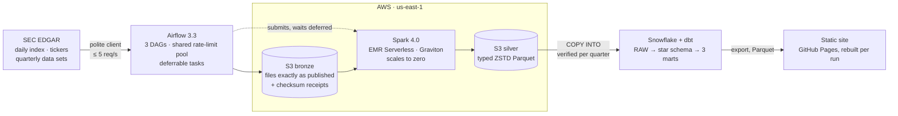

# EarningsWatch

**Flags public companies whose reported profits are outrunning their cash, from 17 years of
SEC filings.**

[](https://github.com/DiegoFranGarcia/Earnings-Watch/actions/workflows/ci.yml)


[](https://diegofrangarcia.github.io/Earnings-Watch/)

When net income rises while operating cash flow falls, the gap is made of *accruals*: profit
not (yet) backed by cash. Accounting research links large accruals to lower-quality earnings
and later restatements. EarningsWatch builds the data platform to screen for that pattern
across every XBRL filer since 2009: idempotent ingestion, a verified lake, Spark on AWS,
and tested models.

> A screen for where to look harder, **not investment advice**.

**Live:** [the site](https://diegofrangarcia.github.io/Earnings-Watch/) and its [dbt docs](https://diegofrangarcia.github.io/Earnings-Watch/dbt-docs/), every model, column and
test with the lineage graph, rebuilt by the pipeline after every dbt build that passes.

## In numbers

| | |
|---|---:|
| SEC financial statement numbers converted and verified | **188,865,271** |
| Quarters of history (2009 Q2 to 2026 Q3) | **70** |
| Raw files in the lake, every one with a checksum receipt | **810+** (35.5 GB) |
| Lines quarantined / values that failed their type cast, across all history | **0 / 0** |
| Full-history conversion on Spark (EMR Serverless) | **24 min, about $0.29** |
| Spark output identical to the reference DuckDB converter | **24 of 24** quarter checks |
| Automated tests | **156** Python, **121** dbt data tests, **7** dbt unit tests |
| Loading the full history into Snowflake | **about $1** of credits |
| Running cost | **about $1/month** (storage), cents per Spark run |

## Architecture



Airflow orchestrates and never crunches data: downloads go to **bronze**, immutable and
receipted; Spark on **EMR Serverless** turns them into typed **silver** Parquet and stops; dbt
models the answer. Airflow runs on one small EC2 host that wakes for the morning's runs and
sleeps the rest of the day, starting whichever release CI last published
([ADR 12](docs/adr/0012-release-by-publishing-a-pointer-the-host-pulls.md)).

## Stack, and why

| Tool | Why it is here |
|---|---|
| **Airflow 3.3** | Logical-date scheduling, backfills, pools as a cross-DAG SEC rate limit, deferrable waits that hold no worker |
| **S3 (bronze / silver)** | Immutable raw files with receipts; open Parquet any engine can read |
| **Spark 4.0 on EMR Serverless** | Keeps heavy compute off the orchestrator; bills per second; idle costs nothing ([ADR 2](docs/adr/0002-run-spark-on-emr-serverless-graviton.md)) |
| **DuckDB** | The single-node baseline Spark is benchmarked against |
| **Snowflake** | Separate storage and compute; loads read S3 through a storage integration, with no stored keys ([ADR 4](docs/adr/0004-run-dbt-on-snowflake-and-retire-the-duckdb-target.md)) |
| **dbt** | Tested, documented models with unit tests and enforced contracts |
| **Terraform** | Every AWS resource as reviewed code, with cost caps built in |
| **GitHub Actions** | Every test, the image built and smoke-tested, vulnerability gates, then the release; AWS through OIDC roles, with no stored keys ([ADR 13](docs/adr/0013-ci-reaches-aws-through-oidc-roles-and-holds-no-real-secret.md), [ADR 15](docs/adr/0015-fix-what-can-be-fixed-accept-the-rest-with-an-expiry.md)) |

Decisions are recorded as [architecture decision records](docs/adr/).

## Design decisions worth asking about

- **Bronze receipts are the commit marker.** Each file's manifest is written last, so a
  rerun skips anything complete. Rerunning the full history (741 runs) wrote **zero** files.
- **Republished data never overwrites history.** A changed SEC file is detected by a cheap
  HEAD check, verified by checksum, and kept beside the original under `version=`.
- **Spark reads back what it wrote.** A job once reported success while its output was never
  committed to S3; now every partition is re-read and counted before success is claimed.
- **Parity, not trust.** The Spark job is tested against the original DuckDB converter on a
  deliberately awkward fixture, and on real data: identical columns, types and rows.
- **Cost guardrails before resources.** EMR has no idle capacity, auto-stops, and has hard
  caps on CPU, memory, disk and concurrent runs; there is no NAT gateway.

## Benchmark: is Spark worth it here?

On the 8 largest quarters (29.5 million rows), measured on the same input:

| Engine | Time | Cost |
|---|---:|---:|
| DuckDB, laptop (M1 Pro) | **47 s** | $0 |
| Spark, laptop | 195 s | $0 |
| Spark, EMR, 12 vCPU | 244 s | $0.05 |
| Spark, EMR, 28 vCPU | 217 s | $0.07 |

**DuckDB wins at this size, and more Spark workers barely help** (+133% vCPU, −11% time): the
job is bound by sequential per-quarter steps, not compute. Spark stays for isolation and
cost shape, not speed. Full method and analysis: [docs/benchmarks.md](docs/benchmarks.md).

## What the warehouse answers

- **Earnings quality:** trailing-twelve-month income rising while cash does not, with accruals
  above 10% of assets, flags **2.2%** of screened company-quarters (the naive rule: 17.8%).
  Of the flags a latest-values-only screen would show, **10% were not knowable at the time**
  ([ADR 6](docs/adr/0006-keep-first-reported-and-latest-values.md)).
- **Restatements:** of 328,872 materially restated facts, only **10% are corrections**; 62%
  are recasts and 28% are XBRL tag switches ([ADR 7](docs/adr/0007-classify-restatements-by-their-first-material-change.md)).
- **Filing timeliness:** for fiscal 2024, 98% of large accelerated filers filed their 10-K on
  time, against 76% of non-accelerated filers, 40% of whose late filers had filed a notice.

Every fact keeps the company version true when it was filed (a Type 2 dimension rebuilt from
17 years of filings), and the company-quarter fact merges incrementally by affected keys, so a
restatement of a 2019 quarter arriving today is absorbed correctly
([ADR 5](docs/adr/0005-merge-incrementally-by-affected-company-and-metric.md)).

## Data quality, found and handled

Every check that fired was investigated against the data before anything was changed:

- **The SEC's documentation was wrong about quoting:** fields containing tabs are quoted.
  Naive parsing silently shifted rows into the wrong columns; reconciliation caught it.
- **Three business days had no EDGAR index** (a national day of mourning, two Christmas-week
  closures). The pipeline skipped them by design and the reconciliation flagged them; SEC
  announcements confirmed all three.
- **A filer dated figures to the year 204.** Reported as a warning, not a pipeline failure.
- **3,048 restatements were thousandfold scale errors**, e.g. a 10-K/A turning a $107m loss
  into $107 billion. Flagged, so they never pass for real corrections.
- **The SEC re-coded filer statuses in 2018 and 2020.** Trends follow deadline groups instead
  ([ADR 9](docs/adr/0009-group-filer-statuses-by-deadline.md)). Problems in filer data warn;
  problems in our logic fail ([ADR 8](docs/adr/0008-filer-data-problems-warn-our-logic-fails.md)).
- **A circuit breaker guards the marts.** A volume gate stops `dbt_build` when the newest data is
  implausible; drilled by deleting 60% of a quarter: the marts stayed byte-identical
  ([ADR 10](docs/adr/0010-a-circuit-breaker-before-the-marts-publish.md), [chaos drills](docs/chaos.md)).
- **Every dbt result, finding and cost is kept in `AUDIT`.** One model, `mart_pipeline_health`,
  answers whether the data is correct, complete and fresh, and what it cost, for the last 30 days.
  A full dbt build costs about $0.12–0.18; warehouse idle time nearly doubles small runs' bills.
- **Conflicting values for the same reported number** have grown since 2024 Q3 (up to 98 rows
  a quarter); they are kept and flagged for the models to resolve, never silently dropped.

## Status

| Stage | |
|---|---|
| 0. Foundations: AWS guardrails, Terraform, CI | ✅ |
| 1. Ingestion: 3 Airflow pipelines, full history backfilled and reconciled | ✅ |
| 2. Spark on EMR Serverless, benchmark published | ✅ |
| 3. Snowflake warehouse: keyless S3 access, verified loads | ✅ |
| 4. dbt star schema: company history, restatements, timeliness | ✅ |
| 5. Orchestration end to end: asset-triggered DAGs, Cosmos, alerts | ✅ |
| 6. Data quality and observability: AUDIT, circuit breaker, cost per run, chaos drills | ✅ |
| 7. Deployment: EC2 on a schedule, releases pulled with automatic fallback, nightly backups, rebuild drilled | ✅ |
| 8. CI/CD: OIDC roles, slim dbt CI, smoke tests, vulnerability gates and weekly scans, protected main | in progress |
| 9. Demo: dashboard, video, write-up | |

A thin end-to-end slice (one quarter, DuckDB, dbt, Streamlit) was built first, so modelling
problems surfaced in week three rather than week fifteen.

## Run it

```bash
uv sync                                    # Python 3.12 environment
uv run pytest -q                           # all tests (Spark tests need Java 17)

cd airflow && docker compose up -d         # Airflow on http://localhost:8080
cd dbt && uv run dbt build                 # models and tests, on Snowflake
```

The public site is built in `site/` and deployed by `.github/workflows/site.yml`
(docs/runbook.md, *The public site*).

Infrastructure lives in `infra/` (Terraform); the Spark job in `spark/`, packaged per commit
with `scripts/package_spark_job.sh`.

## License

MIT
